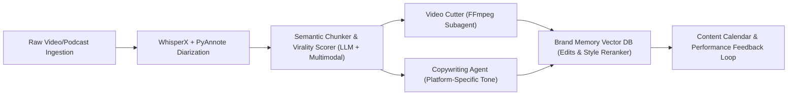
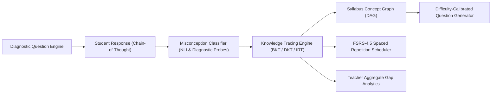
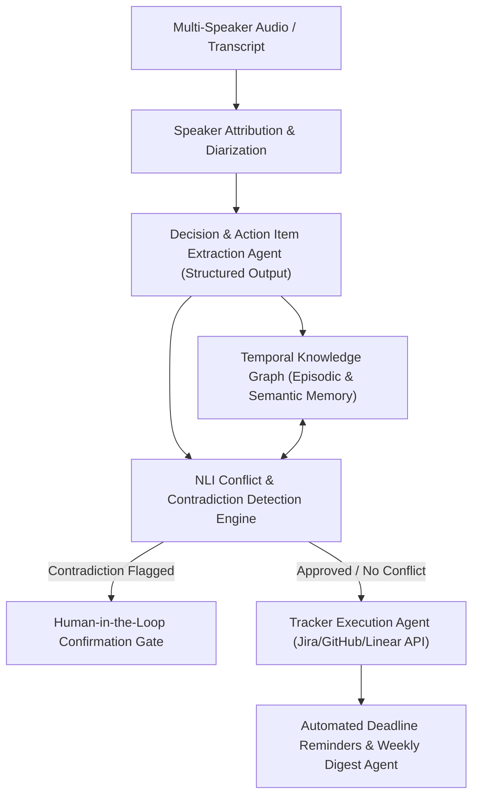
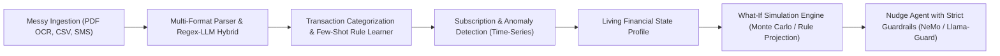
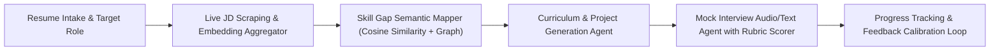

# Agentic AI Hackathon: Strategic AI/ML Project Blueprint & Architectural Specifications

This document provides:
1. **Architectures for all 5 Hackathon Problem Statements**.
2. **The #1 Best Pick for an AI/ML Engineer** (Optimized for GitHub stars, hiring managers, and enterprise value).
3. **End-to-End System Design & Implementation Spec** for the chosen project.
4. **Hackathon Midnight Submission Pitch Deck / Form Content**.
5. **Automated Git/GitHub Push Setup** for voice-driven prompt engineering.

---

## 1. High-Level Architectures of All 5 Hackathon Problem Statements

### Problem 01: Media Repurposing Studio with Brand Memory
* **Core Value**: Turns long-form audio/video into platform-tailored viral clips and copy with adaptive brand voice memory.
* **Architecture Diagram**:

* **AI/ML Focus**: Multimodal chunking, engagement prediction, few-shot preference fine-tuning.

---

### Problem 02: Adaptive Exam-Prep Tutor with Learner Model
* **Core Value**: Tracks true conceptual mastery using dynamic student modeling, misconception reasoning, and spaced repetition.
* **Architecture Diagram**:

* **AI/ML Focus**: Bayesian/Deep Knowledge Tracing, Item Response Theory (IRT), Concept DAG traversals.

---

### Problem 03: Meeting-to-Execution Agent (⭐ Top AI/ML Recommendation)
* **Core Value**: Extracts decisions and action items, maintains a cross-meeting temporal knowledge graph, and alerts on contradictions against historical commitments.
* **Architecture Diagram**:

* **AI/ML Focus**: Natural Language Inference (Entailment vs Contradiction), Temporal Knowledge Graphs, Cross-Meeting Graph RAG, Agentic Verification Loop.

---

### Problem 04: Personal Finance Coach with Living Money Model
* **Core Value**: Unifies messy statements, learns user corrections, and models what-if simulations with safe guardrails.
* **Architecture Diagram**:

* **AI/ML Focus**: Unstructured data extraction, time-series anomaly detection, tabular classification, guardrails.

---

### Problem 05: Career Pivot Coach
* **Core Value**: Evaluates skill gaps against live market job descriptions, generates tailored learning roadmaps, and conducts mock interviews.
* **Architecture Diagram**:

* **AI/ML Focus**: Dense embeddings, semantic similarity, LLM-as-a-judge rubric scoring.

---

## 2. Why Problem 03 is the #1 Pick for an AI/ML Engineer

| Evaluation Dimension | Problem 03: Meeting-to-Execution Agent | Other 4 Problems |
| :--- | :--- | :--- |
| **Industry Demand** | Enterprise AI agent memory & workflow orchestration is the #1 enterprise investment sector. | Consumer apps / EdTech / Social media tools have higher churn and narrower enterprise relevance. |
| **Resume Impact** | Showcases **Graph RAG**, **Natural Language Inference (NLI)**, **Temporal Reasoning**, and **Self-Correction**. | Often dismissed as simple "prompt engineering" or standard "RAG pipelines". |
| **Algorithmic Rigor** | Detects factual contradictions using bi-encoder/cross-encoder contradiction scores + symbolic graph rules. | Standard classification or summarization APIs. |
| **Voice Alignment** | Directly operates on audio/voice transcripts, aligning with your voice-first development approach. | Text-centric or visual. |

---

## 3. Deep Dive: Problem 03 (Meeting-to-Execution Agent)

### 3.1 Project Name & Elevator Pitch
* **Project Name**: **SynapseMeet** (or **ChronosAgent**)
* **Pitch**: *An autonomous Meeting-to-Execution Agent powered by Temporal Knowledge Graphs and NLI Contradiction Engines. Unlike trivial summarizers, SynapseMeet ingests multi-speaker meeting audio, extracts explicit commitments, cross-references them against an evolving cross-meeting memory graph to detect policy/decision conflicts, and commits verified actions directly to enterprise trackers (Jira/Linear/GitHub).*

### 3.2 Technical Component Breakdown

```
synapse-meet/
├── data/                      # Sample audio recordings and benchmark transcripts
├── src/
│   ├── ingestion/             # Audio processing, WhisperX & PyAnnote speaker diarization
│   ├── extraction/            # Pydantic structured output models for decisions & tasks
│   ├── memory/                # Temporal Knowledge Graph (NetworkX / Neo4j + Vector DB)
│   ├── reasoning/             # NLI Contradiction & Conflict Resolution Engine
│   ├── execution/             # Human-in-the-loop review interface & Linear/GitHub API connectors
│   └── cron/                  # Reminder agent & weekly personalized digest generator
├── evaluation/                # Benchmark dataset measuring conflict detection precision/recall
├── tests/                     # Unit & integration tests
├── .env.example
└── README.md                  # Comprehensive resume-grade documentation & architecture diagrams
```

#### A. Ingestion & Diarization Engine
* **Model**: Whisper-large-v3 / Groq Whisper + PyAnnote-audio 3.1 for speaker segmentation.
* **Output**: Time-stamped JSON array with `speaker_id`, `utterance`, `start_time`, `end_time`.

#### B. Structured Extraction Agent
* **Technique**: Pydantic structured output with constrained JSON decoding.
* **Schema**:
  ```python
  class DecisionItem(BaseModel):
      decision_id: str
      topic: str
      statement: str
      owner: str
      participants_agreed: list[str]
      timestamp: datetime
      confidence_score: float

  class ActionItem(BaseModel):
      task_id: str
      description: str
      assignee: str
      due_date: Optional[datetime]
      dependencies: list[str]
  ```

#### C. Cross-Meeting Temporal Knowledge Graph (Memory)
* **Storage**: Hybrid Graph-Vector structure.
* **Graph Schema**:
  - `(Entity:Project) <-[:PART_OF]- (Entity:Decision) -[:SUPERSEDES]-> (Entity:PastDecision)`
  - `(Entity:Person) -[:COMMITTED_TO]-> (Entity:Task) -[:DUE_AT]-> (Entity:Date)`
* **Temporal Tracking**: Each node and edge stores validity intervals `[valid_from, valid_to]`.

#### D. NLI Conflict & Contradiction Detection Engine
* **The Core AI Innovation**:
  When a new decision $D_{new}$ is proposed, the system queries the knowledge graph for related historical decisions $D_{hist}$.
  A Cross-Encoder model (e.g. `roberta-large-snli_mnli` or zero-shot LLM with logit calibration) computes:
  $$\text{Softmax}(P(\text{Entailment}), P(\text{Neutral}), P(\text{Contradiction}))$$
* **Conflict Trigger**: If $P(\text{Contradiction}) > \tau$ (e.g., 0.75), an alert is generated:
  > *"Warning: In today's meeting, Alex proposed migrating to PostgreSQL by Dec 15, contradicting Sarah's approved decision from Oct 12 to maintain DynamoDB until Q2 2027."*

#### E. Human-in-the-Loop & Execution Connectors
* Interactive approval card presented in the UI/CLI.
* On confirmation: dispatches webhook to Linear / Jira / GitHub Issues API.

---

## 4. Hackathon Midnight Submission Copy (Ready to Submit)

Use this exact text for your submission form:

* **Selected Track/Problem Statement**: **Problem 03 - Meeting-to-Execution Agent with Cross-Meeting Memory**
* **Project Title**: **SynapseMeet: Autonomous Meeting-to-Execution Agent with Temporal Knowledge Graphs & Conflict Detection**
* **One-Line Summary**: *An enterprise agentic system that transforms multi-speaker meeting audio into verified, conflict-free actionable tasks with persistent cross-meeting memory.*
* **The Core Problem**: *Decisions and commitments made in corporate meetings evaporate into forgotten notes. Existing tools merely summarize transcripts without tracking commitment lifecycles, leading to unnoticed contradictions between past and present decisions.*
* **Proposed AI/ML Solution**:
  1. **Speaker-Attributed Ingestion**: Audio diarization and timestamped transcription.
  2. **Deterministic Extraction**: Structured JSON extraction of action items, owners, and explicit decisions.
  3. **Temporal Memory Graph**: Persistent Graph RAG mapping entity relationships, deadlines, and project milestones across time.
  4. **NLI Contradiction Engine**: Natural Language Inference pipeline that compares newly declared decisions against historical commitments to flag regressions or conflicting deadlines.
  5. **Guarded Execution & Digests**: Human-in-the-loop review interface triggering automated issue creation (Jira/GitHub), proactive reminder triggers, and personalized weekly digests.
* **Tech Stack**: Python, LangGraph / CrewAI, PyAnnote / Whisper, Neo4j / NetworkX, ChromaDB / Qdrant, FastAPI, Pydantic, Streamlit / Next.js.
* **Expected Impact**: Eliminates cross-functional alignment drift, guarantees 100% action-item accountability, and saves 4+ hours/week per engineering and product manager.

---

## 5. Automated Git Commit-and-Push Script (Voice-Assisted Workflow)

To ensure every prompt or milestone is committed and synced directly to GitHub without breaking your flow:

1. Initialize git and link to your GitHub repository:
   ```powershell
   git init
   git branch -M main
   # Add your remote:
   git remote add origin https://github.com/<your-username>/<your-repo-name>.git
   ```
2. We have created a helper PowerShell script `sync-git.ps1` in the workspace root. Run it whenever you want to commit:
   ```powershell
   .\sync-git.ps1 "voice prompt: added NLI contradiction module"
   ```
   Or have Antigravity run it automatically after every major step.
