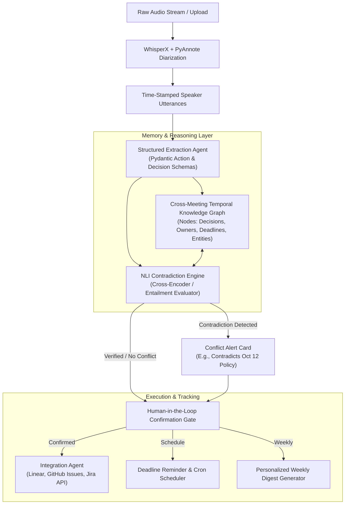

<div align="center">

# ⚡ SynapseMeet: Autonomous Meeting-to-Execution Agent
### *Autonomous Cross-Meeting Memory, NLI Contradiction Engine, and Guarded Execution*

[](https://www.python.org/downloads/)
[](https://opensource.org/licenses/MIT)
[](https://github.com/langchain-ai/langgraph)
[](https://networkx.org/)

</div>

---

## 🎯 Executive Summary
Most AI meeting tools are merely **transcript summarizers** — they compress audio into text, but decisions remain lost in docs, and commitments easily slip. Crucially, they lack **cross-meeting memory**: they cannot detect when a decision agreed upon today directly contradicts a policy, architecture, or deadline approved two weeks ago.

**SynapseMeet** is an agentic, production-grade intelligence layer that:
1. **Ingests multi-speaker conversations** with speaker attribution & timestamps.
2. **Deterministically extracts** decisions, action items, assignees, and deadlines into verified schemas.
3. **Maintains a Temporal Knowledge Graph** representing organizational decisions, dependencies, and owners across time.
4. **Detects Cross-Meeting Conflicts via Natural Language Inference (NLI)**, calculating semantic contradiction probabilities ($P(\text{Contradiction})$) before any task is created.
5. **Executes to Trackers (Linear / Jira / GitHub Issues)** through a guarded, human-in-the-loop review interface.
6. **Dispatches automated pre-deadline reminders** and compiles **personalized weekly execution digests** per team member.

---

## 🏗️ System Architecture



---

## 🔬 AI/ML Innovations

### 1. Cross-Meeting Contradiction Detection (NLI)
When an extracted decision $D_{new}$ is proposed, the system performs Graph RAG to retrieve historical decisions $D_{hist}$ related to the topic. A Cross-Encoder NLI model computes:
$$\text{Softmax}(P(\text{Entailment}), P(\text{Neutral}), P(\text{Contradiction}))$$
If $P(\text{Contradiction}) > 0.70$, an automated conflict alert is triggered with exact citations from past meetings.

### 2. Temporal Knowledge Graph Memory
Rather than relying on flat vector search (which suffers from temporal blindness), SynapseMeet models organizational state as a temporal directed graph:
- `(Person:Alice) -[:COMMITTED_TO]-> (Task:T1) -[:DUE_AT]-> (Date:2026-11-15)`
- `(Decision:D2) -[:SUPERSEDES]-> (Decision:D1)`
Nodes and edges carry valid-time timestamps `[valid_from, valid_to]`.

---

## 🚀 Quickstart

### Prerequisites
- Python 3.10+
- PyTorch & CUDA (optional for local WhisperX / NLI acceleration)

### 1. Installation
```bash
git clone https://github.com/SatyaRamDinkar/SynapseMeet.git
cd SynapseMeet
python -m venv venv
# Windows:
.\venv\Scripts\activate
# Linux/macOS:
source venv/bin/activate

pip install -r requirements.txt
```

### 2. Configure Environment
```bash
cp .env.example .env
# Edit .env with your OpenAI / Gemini / Groq API keys and Linear / GitHub tokens
```

### 3. Run Pipeline Demo
```bash
python -m src.main
```

---

## 📁 Repository Structure

```
SynapseMeet/
├── data/
│   └── sample_transcripts/    # Multi-speaker sample meetings with conflicting decisions
├── src/
│   ├── ingestion/             # Audio processing & speaker diarization
│   ├── schemas/               # Pydantic data models for decisions, tasks & alerts
│   ├── memory/                # Temporal Knowledge Graph (NetworkX / Graph RAG)
│   ├── reasoning/             # NLI Contradiction and Conflict Detection Engine
│   ├── execution/             # Human-in-the-loop confirmation & tracker connectors
│   ├── cron/                  # Reminder agent & weekly digest generator
│   └── main.py                # Pipeline entrypoint and orchestration
├── HACKATHON_PROJECT_PROPOSAL.md  # Complete problem statement & evaluation breakdown
├── sync-git.ps1               # Automated git push script for prompt iterations
├── requirements.txt           # Python dependencies
└── README.md                  # Project overview and documentation
```

---

## 👨‍💻 Author
**Satya Ram Dinkar**
- GitHub: [@SatyaRamDinkar](https://github.com/SatyaRamDinkar)
- Role: AI/ML Engineer
